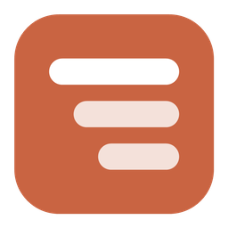

<div align="center">



# SessionBoard

**Claude Code oturumlarınızı klasöre ve gruba ayıran, istediğiniz sırada tutan pencere.**

Windows için · Claude masaüstü uygulamasının yanında çalışır · Ücretsiz ve açık kaynak

[](https://github.com/NYAYAN/claude-session-board/releases/latest)
[](https://github.com/NYAYAN/claude-session-board/actions/workflows/check.yml)
[](LICENSE)

**[İndir](https://github.com/NYAYAN/claude-session-board/releases/latest)** &nbsp;·&nbsp;
[Kurulum](#paketi-indirip-kurmak) &nbsp;·&nbsp;
[Öne çıkanlar](#öne-çıkanlar) &nbsp;·&nbsp;
[Kısayollar](#klavye-kısayolları) &nbsp;·&nbsp;
[Belgeler](#belgeler)


</div>

## Öne çıkanlar

### Her klasör kendi ağacında

Claude'un kenar çubuğu oturumları aynı anda yalnız tek ölçüte göre gruplayabiliyor: ya klasöre ya özel
gruplara. SessionBoard ikisini birlikte gösterir. Oturumlar açıldıkları klasörün altında toplanır, her
klasörün içinde kendi gruplarınız ve gerekirse onların alt grupları durur; worktree'de açılan oturumlar
reponun kendi klasörüne bağlanır.
Sık kullandığınız klasörleri yıldızla işaretleyip tek tıkla süzebilir, işiniz bitenleri gizleyebilirsiniz.

### Sürükleyerek düzenleyin

Klasörleri, grupları ve oturumları sürükleyerek sıralayın. Bir oturumu başka bir oturumun üst ya da alt
yarısına bırakınca önüne ya da arkasına geçer; o oturum başka bir gruptaysa oraya, tam o konuma taşınır.
Ctrl ve Shift ile seçtiğiniz oturumlar birlikte taşınır. Henüz sıraya koymadığınız yeni oturumlar grubun
en üstünde, son etkinliğe göre durur; dizdiğiniz listenin ortasında kaybolmazlar.

<p align="center">
  
  
</p>

### Kaldığınız yerden, terminalde

Oturumun üzerine gelince iki düğme çıkar. Biri konuşmayı uygulamanın içindeki terminalde
`claude --resume` ile sürdürür; her oturum kendi sekmesinde açılır. Diğeri oturumu Claude masaüstü
uygulamasında açar. *Kopyasını terminalde aç* konuşmanın bir kopyasıyla yeni oturum başlatır, asıl oturum
değişmez. Tek tık yalnızca seçer, hiçbir şeyi açmaz.

Aynı oturumu terminalde ve Claude penceresinde aynı anda kullanmayın: ikisi aynı konuşma dosyasına yazar.
Emin değilseniz kopyasını açın.

### Claude'un dosyalarına dokunmaz

Oturum listesi Claude'un kendi kayıtlarından yalnızca okunur. Gruplar, sıralar ve tercihler
SessionBoard'un kendi dosyasında durur; SessionBoard'da ne yaparsanız yapın Claude'daki hiçbir şey
değişmez.

### Ve dahası

- **Arama:** Ctrl+F; Türkçe karakterlere duyarsız (`cetele` → *Çetele*), başlıkta ve dal adında arar.
- **Klasör birleştirme:** projeyi başka bir klasöre taşıdıysanız eski klasörde kalan oturumları yenisinin
  altında toplayın; istediğinizde ayırın.
- **Uzun grup listeleri:** *Gruba taşı* menüsü ilk beş grubu gösterir, kalanlar *Daha fazla* ile açılır.
- **Kendiliğinden güncelleme:** yeni sürüm uygulamanın içinden gelir; paket imzası doğrulanarak kurulur.
- **Kendiliğinden yenileme:** liste 20 saniyede bir ve pencereye dönünce tazelenir; arşivlenmiş oturumlar
  istenirse gösterilir.
- **Pencere:** her zaman üstte kalabilir; boyutu, konumu ve ağacın genişliği hatırlanır.

## Paketi indirip kurmak

Son sürüm: **[Releases › Latest](https://github.com/NYAYAN/claude-session-board/releases/latest)**.
Bir kez kurduktan sonra yeni sürümler **uygulamanın içinden** gelir (listenin üstünde **Güncelle**, ya da
*⋯ › Güncellemeleri denetle*); aşağıdaki adımlar yalnızca ilk kurulum için.

**Windows 10/11:** `SessionBoard_<sürüm>_x64-setup.exe` dosyasını indirip çalıştırın. Kurulum yönetici
izni istemez, uygulama kullanıcı klasörüne kurulur. Paket imzasız olduğu için Windows "Windows
bilgisayarınızı korudu" (*Windows protected your PC*) diyebilir: **Ek bilgi** (*More info*) ›
**Yine de çalıştır** (*Run anyway*).

v0.1.0 kullanıyorsanız o sürümde güncelleyici yok; yeni sürümü bir kez elle kurun. Gruplarınız ve
sıralarınız kurulumdan etkilenmez.

**Gerekenler.** Claude masaüstü uygulaması; oturum listesi onun kayıtlarından okunur. Windows 10'da
[WebView2 Runtime](https://developer.microsoft.com/microsoft-edge/webview2/) (Windows 11'de yerleşik).
Gömülü terminal için bağımsız Claude Code CLI; PowerShell'de bir kez kurup giriş yapın:

```powershell
irm https://claude.ai/install.ps1 | iex
claude   # tarayıcıdan giriş yapın, sonra /exit
```

Masaüstü uygulamanın içindeki Claude kopyası terminalde kullanılamaz: onun oturum açma bilgisini
masaüstü uygulama sağlıyor. Ayrıntı: [docs/ozellikler.md](docs/ozellikler.md#gömülü-terminal).

## Klavye kısayolları

| Ne yapar | Kısayol |
|---|---|
| Oturum ara | Ctrl+F |
| Listeyi yenile | F5 / Ctrl+R |
| Seçime ekle / çıkar | Ctrl + tık |
| Aralık seç | Shift + tık |
| Menüyü kapat, aramayı temizle, seçimi kaldır (sırayla) | Esc |
| Terminalde kopyala | Ctrl+C (seçim varken) / Ctrl+Shift+C |
| Terminalde yapıştır | Ctrl+V |
| Terminal sekmesini kapat | Orta tık |

Tam liste ve fare davranışları: [docs/ozellikler.md](docs/ozellikler.md#klavye-kısayolları).

## Verileriniz

Gruplar, sıralar ve tercihler sizin bilgisayarınızda, tek bir dosyada durur; hiçbir yere gönderilmez.
Uygulama ağ üzerinden yalnızca yeni sürüm olup olmadığını GitHub'a sorar.

| Dosya | İçerik |
|---|---|
| `%USERPROFILE%\.sessionboard\state.json` | Gruplar, atamalar, sıralar, tercihler |
| `%USERPROFILE%\.sessionboard\state.json.bak` | Bir önceki kayıt |

Claude'un oturum kayıtlarına hiçbir şey yazılmaz. Dosyanın içeriği ve neden AppData'da olmadığı:
[docs/ozellikler.md](docs/ozellikler.md#veri-dosyaları).

## Belgeler

| Belge | İçinde ne var |
|---|---|
| [Özellikler ve kullanım](docs/ozellikler.md) | Her özelliğin ayrıntısı: ağaç, gruplar, sürükle-bırak, menüler, terminal, güncelleme, veri dosyaları |
| [Kaynaktan derleme](KURULUM.md) | Hangi klasörde hangi komut, hangi dosya oluşuyor |
| [Geliştirme](docs/gelistirme.md) | Mimari, kararların nedenleri, testler, CI, sürüm çıkarma ve güncelleme anahtarı |

SessionBoard [Tauri 2](https://tauri.app) (Rust), paketleyicisiz düz JavaScript ve
[xterm.js](https://xtermjs.org) ile yazıldı. Terminal katmanı `portable-pty` üzerinden Windows'un
ConPTY'sini kullanır.

## Lisans

[ISC](LICENSE) © 2026 Nurullah YAYAN
