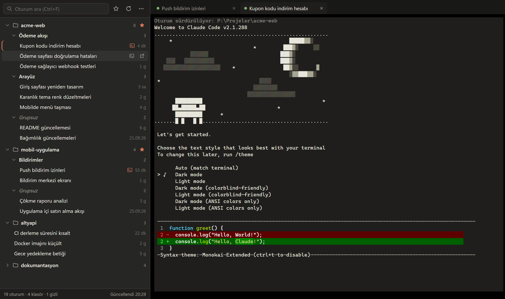
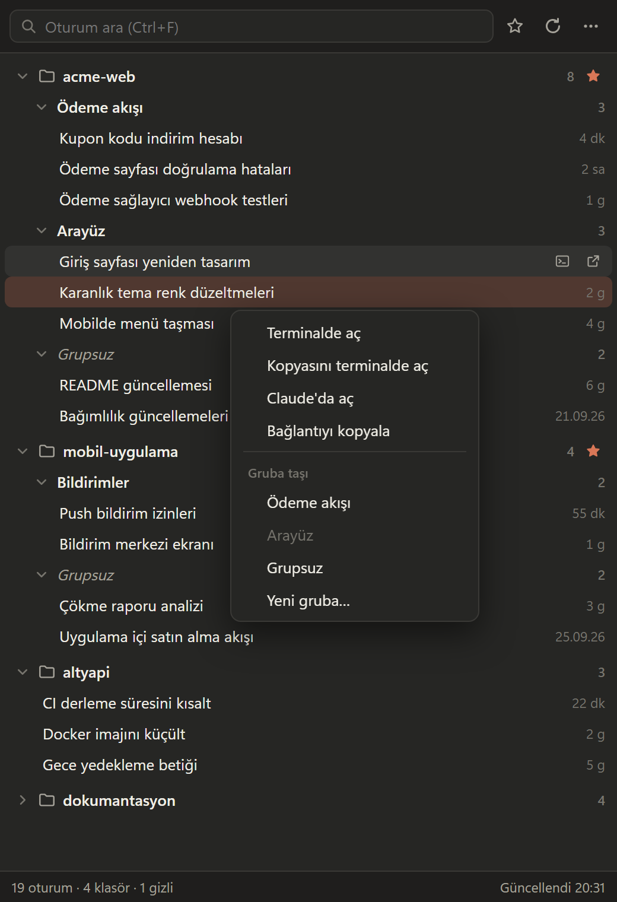
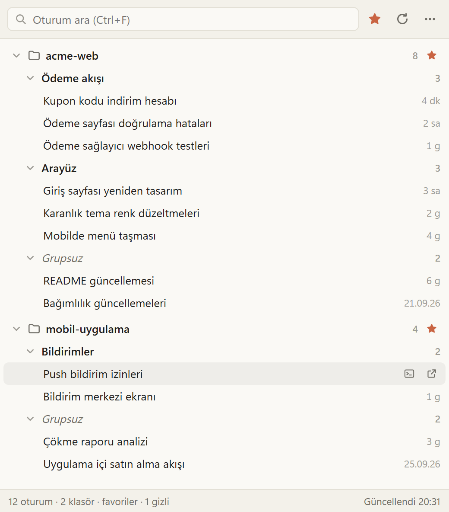

# SessionBoard

> **Claude Code oturumları için klasör → grup → oturum düzenleyici ve gömülü terminal**

[](https://github.com/NYAYAN/claude-session-board/actions/workflows/check.yml)
[](https://github.com/NYAYAN/claude-session-board/releases/latest)


SessionBoard, Claude masaüstü uygulamasındaki Claude Code oturumlarını **klasör → grup → oturum** ağacında
düzenleyen küçük bir Windows uygulamasıdır. Claude'un kenar çubuğu aynı anda yalnız tek ölçüte göre
gruplayabildiği için (klasör *ya da* özel gruplar) bu ihtiyaç ayrı bir pencerede karşılanır. Oturumlar
istenirse uygulamanın içindeki terminalde (`claude --resume`) sürdürülebilir.

<p align="center">
  
</p>

> Diğer ekranlar için: **[📸 Ekran Görüntüleri](#-ekran-görüntüleri)**

---

## ✨ Özellikler

### 🗂️ 1. Klasör → Grup → Oturum Ağacı
- **Klasörler:** Oturumlar açıldıkları klasöre (workspace) göre toplanır; worktree oturumları reponun köküne bağlanır.
- **Gruplar:** Klasör satırındaki **+** ile gruba ayırın; gruba atanmamış oturumlar *Grupsuz*'da durur.
- **Favoriler ve gizleme:** Klasör satırındaki ☆ favorilere ekler, üst çubuktaki ★ yalnız favorileri gösterir; göz düğmesi klasörü gizler (⋯ → *Gizli klasörleri göster*).
- **Klasör birleştirme:** Bir projeyi yeni bir klasöre taşıdıysanız sağ tık → *Bu klasörü şunun altına kat* eski klasörde kalan oturumları yenisinin altında toplar; *Ayır* ile geri alınır.

### 🔀 2. Sürükle-Bırak ile Düzen
- **Klasör sırası:** Klasör satırını başka bir klasörün önüne/arkasına bırakın.
- **Grup sırası:** Grup satırını aynı klasördeki başka bir grubun önüne/arkasına bırakın; *Grupsuz*'un üzerine bırakmak sona koyar.
- **Oturum sırası:** Oturumu başka bir oturumun üst/alt yarısına bırakın, önüne/arkasına geçer — aynı grupta sıralar, başka gruptaysa oraya o konumda taşır. Grup başlığına bırakmak en üste koyar; *Grupsuz*'a bırakmak gruptan çıkarır.
- **Çoklu seçim:** `Ctrl` + tık (tek tek), `Shift` + tık (aralık); seçili oturumlar sıralarını koruyarak birlikte taşınır.
- **Sırayı sıfırlama:** Sağ tık → *Oturumları son etkinliğe göre sırala* (grupta o grubu, klasörde tümünü).

Elle sıraya girmemiş oturumlar (yeni açılanlar, menüyle taşınanlar) grubun en üstünde, son etkinliğe göre
durur — yeni bir oturum elle dizdiğiniz listenin ortasında kaybolmasın diye. Aramadayken sıralama kapalıdır:
süzülmüş bir listede "şunun arkasına" demenin gizli oturumlar için anlamı yok.

> Sürükle-bırak Tauri'nin `dragDropEnabled` ayarı kapalı olmadan **çalışmaz**: açıkken pencereye işletim
> sistemi düzeyinde bir dosya-bırakma yakalayıcısı takılır ve sayfa içindeki HTML5 sürükleme olaylarını
> yutar. Bu yüzden `tauri.conf.json`'da kapalıdır.

### 📋 3. Sağ Tık Menüleri
- **Oturum:** Terminalde aç, *Kopyasını terminalde aç*, Claude'da aç, bağlantıyı kopyala, *Gruba taşı*.
- **Gruba taşı:** İlk 5 grup görünür, kalanlar *Daha fazla (N)…* ile aynı yerde açılır — onlarca grupta menü ekranı aşmasın diye.
- **Grup:** Yeniden adlandır, yukarı/aşağı taşı, oturumları son etkinliğe göre sırala, sil (oturumlar *Grupsuz*'a döner).
- **Klasör:** Grup ekle, yeniden adlandır, favori, gizle, yukarı/aşağı taşı, başka klasörün altına kat.

### 🖥️ 4. Gömülü Terminal
- **Sürdür:** Oturumun üzerine gelince çıkan terminal düğmesi oturumu sağdaki terminalde `claude --resume` ile sürdürür; açıksa o sekmeye geçer.
- **Kopyasını aç:** *Kopyasını terminalde aç* (`--fork-session`) konuşmanın kopyasıyla yeni oturum başlatır; asıl oturum değişmez.
- **Sekmeler:** Her oturum bir sekme; orta tık ya da × kapatır (çalışan Claude sonlanır, konuşma kaydı kalır).
- **Genişlik:** Ağaçla terminal arasındaki çizgi sürüklenerek ayarlanır.

> ⚠️ Aynı oturumu terminalde ve Claude penceresinde **aynı anda** kullanmayın: ikisi aynı konuşma
> dosyasına yazar. Emin değilseniz *Kopyasını terminalde aç*'ı kullanın.

### 🚀 5. Claude'da Açma
- Oturumun üzerindeki ikinci düğme oturumu Claude masaüstü uygulamasında açar. **Tek tık yalnız seçer**, hiçbir şey açmaz — yanlışlıkla bir oturuma geçmemek için.

### 🔍 6. Arama ve Görünüm
- **Arama:** `Ctrl+F`; Türkçe karakterlere duyarsız (`cetele` → *Çetele*), başlıkta ve dal adında arar.
- **⋯ menüsü:** Arşivlenmiş oturumlar, gizli klasörler, her zaman üstte, tümünü daralt/genişlet.
- **Kendiliğinden yenileme:** Liste 20 sn'de bir ve pencere odaklandığında yenilenir; `F5` elle yeniler.

### 🔄 7. Otomatik Güncelleme
- Açılışta ve 6 saatte bir GitHub'daki son sürüm denetlenir; yeni sürüm varsa listenin üstünde **Güncelle** çıkar.
- Paket indirilir, imzası doğrulanır, kurulur ve uygulama yeniden açılır (terminalde çalışan Claude oturumları kapanır, konuşma kayıtları kalır).
- Elle denetlemek için ⋯ → *Güncellemeleri denetle*; çalışan sürüm aynı menüde yazar.

### 🔒 8. Claude'un Dosyalarına Dokunmaz
- Oturum listesi Claude'un kayıtlarından **salt okunur**; gruplar, sıralar ve tercihler yalnız SessionBoard'un kendi dosyasındadır (bkz. [Nasıl çalışır](#-nasıl-çalışır)).

---

## 📸 Ekran Görüntüleri

Görüntülerdeki projeler ve oturumlar örnek veridir. En üstteki görüntü: solda klasör → grup → oturum
ağacı, sağda terminal sekmesinde sürdürülen bir Claude Code oturumu.

<table>
  <tr>
    <td width="50%" valign="top"><br><sub><b>Sağ tık menüsü</b> — terminalde ya da Claude'da aç, bağlantıyı kopyala, gruba taşı.</sub></td>
    <td width="50%" valign="top"><br><sub><b>Yalnız favoriler</b> — açık tema; üzerine gelinen oturumda aç düğmeleri.</sub></td>
  </tr>
</table>

---

## ⌨️ Kısayollar

### Ağaçta

| Kısayol | İşlev |
|---------|-------|
| Tık | Oturumu seçer (açmaz) |
| `Ctrl` + tık | Seçime ekler / çıkarır |
| `Shift` + tık | Aralık seçer |
| Sağ tık | Oturum, grup ya da klasör menüsü |
| Sürükle-bırak | Taşır ve sıralar (bkz. [Sürükle-Bırak ile Düzen](#-2-sürükle-bırak-ile-düzen)) |
| `Ctrl + F` | Aramaya geçer |
| `F5` / `Ctrl + R` | Listeyi yeniler |
| `Esc` | Menüyü kapatır; yoksa aramayı temizler; yoksa seçimi kaldırır |
| `Enter` / `Esc` | Satır içi adlandırmada kaydeder / vazgeçer |

### Terminalde

| Kısayol | İşlev |
|---------|-------|
| `Ctrl + C` | Seçim varsa kopyalar; yoksa Claude'a gider (kesme) |
| `Ctrl + Shift + C` | Kopyalar |
| `Ctrl + V` | Yapıştırır |
| Sağ tık | Seçim varsa kopyalar |
| Orta tık (sekmede) | Sekmeyi kapatır |

---

## 🚀 Kurulum (Kullanıcılar İçin)

1. **[Releases](https://github.com/NYAYAN/claude-session-board/releases/latest)** sayfasından `SessionBoard_<sürüm>_x64-setup.exe` dosyasını indirin.
2. Çalıştırın. Yönetici izni istemez, yalnız kullanıcı için kurulur.
3. Sonraki sürümler uygulamanın içinden **Güncelle** ile gelir.

> **⚠️ Windows SmartScreen:** Kurulum dosyası kod imzalı olmadığı için uyarı verebilir:
> **Ek bilgi** → **Yine de çalıştır**.

> **v0.1.0 kullanıyorsanız:** O sürümde güncelleyici yok; bir kez elle güncel sürümü kurun.
> Gruplarınız ve sıralarınız kurulumdan etkilenmez.

### Gereksinimler

| | |
|---|---|
| Windows | 10 / 11 |
| WebView2 | 11'de yerleşik; 10'da [Evergreen Runtime](https://developer.microsoft.com/microsoft-edge/webview2/) |
| Claude masaüstü | Oturum listesi onun kayıtlarından okunur |
| Claude Code CLI | Yalnız gömülü terminal için — aşağıya bakın |

### Gömülü terminal için Claude Code CLI

Gömülü terminal **bağımsız Claude Code CLI** ister; masaüstü uygulamanın kendi içindeki kopyası
kullanılamaz (onun oturum açma bilgisini masaüstü uygulama sağlar). Windows Terminal ya da PowerShell'de
bir kez kurup giriş yapın:

```powershell
irm https://claude.ai/install.ps1 | iex
claude   # tarayıcıdan giriş yapın, sonra /exit
```

SessionBoard `claude`'u PATH'te, `%USERPROFILE%\.local\bin`'de ve `%APPDATA%\npm`'de arar; kurulumdan
sonra yeniden başlatmak gerekmez. SessionBoard Claude'un içinden başlatıldıysa masaüstünün kendi
süreçlerine verdiği `CLAUDE*` / `ANTHROPIC_BASE_URL` değişkenleri terminaldeki CLI'ye aktarılmaz.

---

## 🔧 Nasıl Çalışır

| Konu | Ayrıntı |
|------|---------|
| Oturum listesi | `<kök>\<hesap>\<org>\local_*.json` — **salt okuma**. Kök: `%LOCALAPPDATA%\Packages\Claude_*\LocalCache\Roaming\Claude\claude-code-sessions` (Claude MSIX/Store paketi; AppData'sı sanallaştırıldığı için kayıtlar fiziksel olarak burada) veya klasik kurulumda `%APPDATA%\Claude\claude-code-sessions` |
| Klasör | Kaydın `originCwd` alanı; worktree oturumları (`…\.claude\worktrees\…`) reponun köküne bağlanır |
| Hesap | Birden çok hesap klasörü varsa en son etkinliğin olduğu hesap gösterilir |
| Oturumu açma | `claude://claude.ai/epitaxy/<oturum-id>` bağlantısı → Windows'ta kayıtlı Claude protokol işleyicisi |
| Terminal | Sözde terminal (ConPTY, `portable-pty`) + xterm.js. Komut: `claude --resume <cliSessionId> [--fork-session] [--permission-mode <mod>]`, çalışma klasörü oturumun `cwd`'si. İzin modu masaüstündeki kayıttan gelir (`bypassPermissions` bilerek geçirilmez) |
| Son etkinlik | Masaüstü kaydı ile konuşma dosyasının (`~\.claude\projects\…\<cliSessionId>.jsonl`) değiştirilme zamanının büyüğü — terminalde çalışınca da güncellenir |
| Kendi durumu | `%USERPROFILE%\.sessionboard\state.json` (her kayıtta önceki sürüm `state.json.bak`): gruplar, atamalar, grup başına elle sıra (`groups[].order`, `ungroupedOrder`), klasör sırası ve tercihler |
| Güncelleme | `tauri-plugin-updater`: son GitHub sürümünün `latest.json`'ı → imzalı NSIS paketi, `tauri.conf.json`'daki açık anahtarla doğrulanıp pasif kipte (yalnız ilerleme çubuğu) kurulur |

> Durum dosyası AppData'da **değil**, çünkü SessionBoard Claude'un terminalinden açılırsa Claude'un MSIX
> paketinin içinde çalışır ve AppData yazımları paketin özel klasörüne yönlenir. Başlat menüsünden açılan
> SessionBoard o dosyayı göremez ve iki ayrı grup listesi oluşurdu. Kullanıcı profilinin kökü
> sanallaştırılmaz; iki durumda da aynı dosya kullanılır.

> ⚠️ Claude'un oturum kayıtları **belgelenmemiş iç biçimdir**. Bir Claude güncellemesi biçimi
> değiştirirse liste boş/eksik gelebilir (alt çubukta "N kayıt okunamadı" görünür). Uygulama Claude'un
> dosyalarına hiçbir şey yazmaz; gruplar yalnız `state.json`'dadır.

---

## 🛠 Geliştirici Kılavuzu

### Gereksinimler

| | |
|---|---|
| Node.js | 20+ |
| Rust | 1.82+ (`x86_64-pc-windows-msvc`) |
| Visual Studio | 2022 ya da Build Tools, **"C++ ile masaüstü geliştirme"** iş yükü |

### Proje Yapısı

```
src/                       # Ön yüz — paketleyicisiz düz JS
├── index.html
├── app.js                 # Ağaç, gruplar, sürükle-bırak, menüler, güncelleme bildirimi
├── terminal.js            # Terminal sekmeleri (xterm.js) ve bölücü çizgi
├── styles.css
└── vendor/                # xterm.js — npm run vendor üretir, depoda yok
src-tauri/                 # Rust / Tauri 2
├── src/
│   ├── main.rs            # Komutlar, eklentiler, pencere
│   ├── sessions.rs        # Claude oturum kayıtlarını okur (salt okuma)
│   ├── store.rs           # state.json okuma/yazma (+ .bak)
│   ├── pty.rs             # ConPTY sözde terminal
│   └── updater.rs         # Güncelleme denetimi ve kurulum
├── capabilities/          # Pencere izinleri
└── tauri.conf.json        # Pencere, CSP, paketleme, güncelleyici açık anahtarı
scripts/vendor.mjs         # xterm dosyalarını src/vendor'a kopyalar
.github/workflows/         # check.yml (her push), release.yml (v* etiketi)
docs/screenshots/          # README görüntüleri
```

### Kurulum ve Çalıştırma

1. **Repoyu klonlayın:**
   ```bash
   git clone https://github.com/NYAYAN/claude-session-board.git
   cd claude-session-board
   ```

2. **Bağımlılıkları yükleyin:**
   ```bash
   npm install
   ```

3. **Geliştirme modunda başlatın:**
   ```bash
   npm run dev
   ```
   *İlk çalıştırma Rust bağımlılıklarını derlediği için birkaç dakika sürer. Kurulu SessionBoard açıksa
   önce onu kapatın: tek pencere kuralı yüzünden yeni süreç açılmaz, eskisi öne gelir. Geliştirme sürümü
   gerçek `state.json`'ı kullanır.*

4. **Testleri çalıştırın:**
   ```bash
   npm run test:rust
   ```
   *Birim testleri (ConPTY uçtan uca testi dahil). `src-tauri` içinde `cargo test -- --include-ignored`
   bilgisayardaki Claude kayıtlarıyla duman testini de koşar.*

5. **Kurulum paketi oluşturun:**
   ```bash
   npm run build
   ```
   *Çıktı: `src-tauri\target\release\bundle\nsis\SessionBoard_<sürüm>_x64-setup.exe`. Güncelleme paketi de
   imzalandığı için imza anahtarı gerekir (bkz. [Sürüm Çıkarma](#-sürüm-çıkarma)); yoksa paketleme
   sonunda "A public key has been found, but no private key" hatası verir. `npm run dev` istemez.*

   ```powershell
   $env:TAURI_SIGNING_PRIVATE_KEY = (Get-Content "$env:USERPROFILE\.tauri\sessionboard.key" -Raw).Trim()
   $env:TAURI_SIGNING_PRIVATE_KEY_PASSWORD = (Get-Content "$env:USERPROFILE\.tauri\sessionboard.key.password" -Raw).Trim()
   ```

Her `tauri build` / `tauri dev` önce xterm.js dosyalarını `node_modules`'tan `src/vendor`'a kopyalar
(`tauri.conf.json` → `beforeBuildCommand`: `npm run vendor`).

> npm'in `prebuild` kancası değil, Tauri'nin `beforeBuildCommand`'ı: CI'daki tauri-action
> `npm run tauri build` çağırır ve o yolda `prebuild` çalışmaz — xterm dosyaları pakette eksik kalırdı.

Her push'ta GitHub Actions (`.github/workflows/check.yml`) `cargo check`, `cargo test` ve JS sözdizimi
denetimini Windows'ta çalıştırır.

### Sorun Giderme: `LNK1104: cannot open file 'msvcrt.lib'`

Rust bilgisayardaki **en yeni** Visual Studio kurulumunu seçer; o kurulumda C++ masaüstü (x64)
kütüphaneleri eksikse bağlayıcı bu hatayla düşer — linker vardır ama `msvcrt.lib` yoktur. Ya o kurulumu
Visual Studio Installer'dan tamamlayın ya da komutu tam bir kurulumun x64 geliştirici ortamında çalıştırın:

```powershell
cmd /c '"<Visual Studio klasörü>\VC\Auxiliary\Build\vcvars64.bat" && npm run build'
```

### 📦 Sürüm Çıkarma

**Bir kerelik hazırlık — imza anahtarı.** Kurulu uygulamalar yalnız bu anahtarla imzalanmış
güncellemeleri kabul eder (açık anahtar `tauri.conf.json` → `plugins.updater.pubkey`). Gizli anahtar
depoda **değil**: `%USERPROFILE%\.tauri\sessionboard.key` (+ `.key.password`). **Yedekleyin**: kaybolursa
kurulu uygulamalar sonraki sürümleri kabul etmez, herkes bir kez elle yeniden kurmak zorunda kalır.
GitHub'a depo sırrı olarak bir kez ekleyin:

```powershell
gh secret set TAURI_SIGNING_PRIVATE_KEY --repo NYAYAN/claude-session-board --body (Get-Content "$env:USERPROFILE\.tauri\sessionboard.key" -Raw).Trim()
gh secret set TAURI_SIGNING_PRIVATE_KEY_PASSWORD --repo NYAYAN/claude-session-board --body (Get-Content "$env:USERPROFILE\.tauri\sessionboard.key.password" -Raw).Trim()
```

**Her sürümde:**

1. Sürümü üç yerde artırın: `src-tauri/tauri.conf.json`, `src-tauri/Cargo.toml`, `package.json`
   (`Cargo.lock` derlemede kendiliğinden güncellenir); commit'leyip push'layın.
2. Etiketi atıp gönderin:

   ```powershell
   git tag v0.2.1
   git push origin v0.2.1
   ```

`.github/workflows/release.yml` etiketi görünce testleri koşar, kurulum paketini derleyip imzalar ve
`SessionBoard v0.2.1` adıyla sürümü yayınlar; sürüme güncelleyicinin okuduğu `latest.json` da eklenir.

> Etiket ile üç dosyadaki sürüm aynı değilse ya da imza sırları tanımlı değilse iş akışı **derlemeye
> başlamadan** durur. İkisi de derlemenin sonunda — on dakika sonra — patlayacak hatalar; baştaki
> denetim o süreyi kurtarıyor.

---

## 👤 Yapımcı

**Nurullah YAYAN**
- 📧 E-posta: nurullah.yayan@gmail.com
- 🐙 GitHub: [NYAYAN](https://github.com/NYAYAN)

---

## 📝 Lisans

Bu proje **ISC** lisansı ile lisanslanmıştır.
